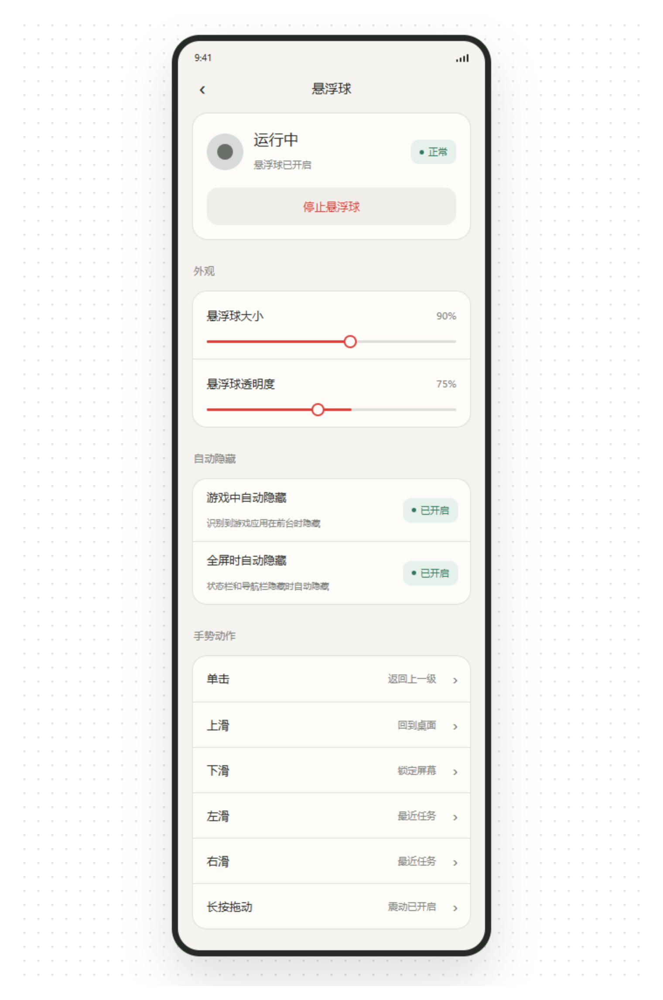
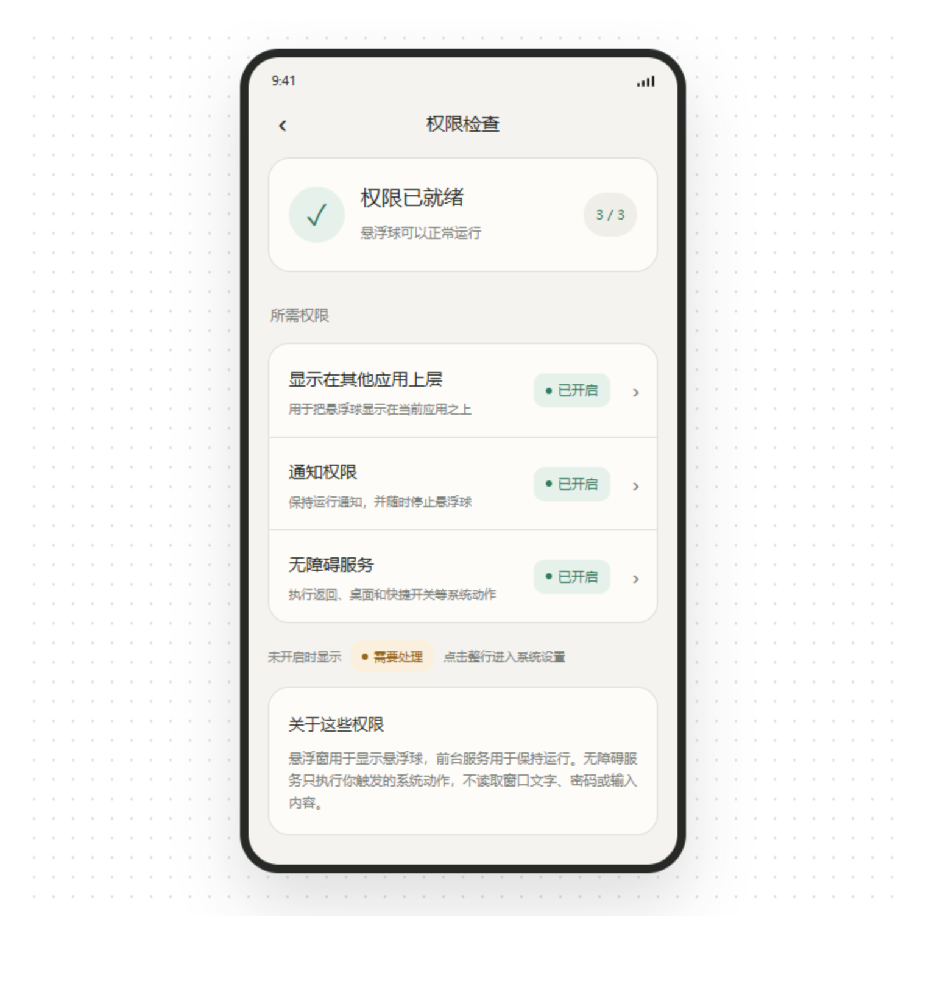
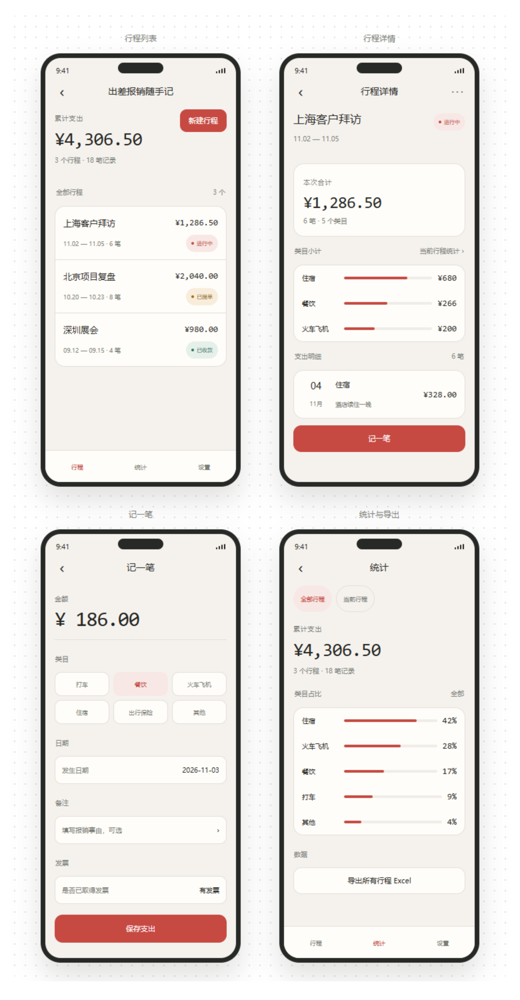
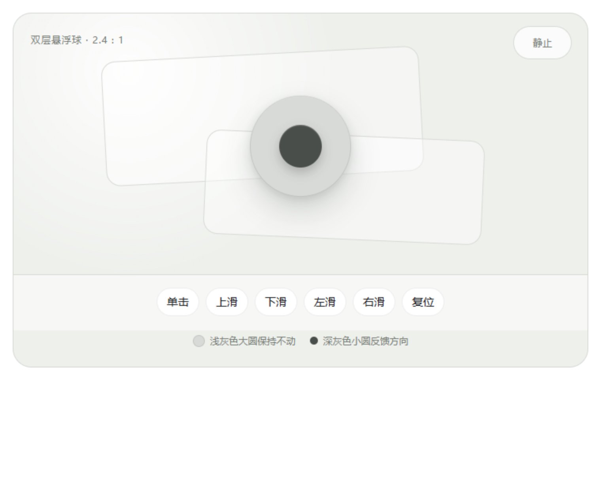

# 独去闲工具箱

> 把常用系统动作放进一个随手可触的悬浮球，再带上一个完全离线的出差报销小工具。

**Android 9+ · Kotlin · 本地运行 · 当前版本 0.9.1**

独去闲工具箱是一款轻量的 Android 效率工具。激活悬浮球后，无需频繁返回桌面，就可以通过单击或四向滑动完成返回、锁屏、打开通知栏、启动指定应用等操作。工具箱内还包含“出差报销随手记”，用于在手机本地记录行程和支出，并导出 Excel 文件。

它不是启动器替代品，也不是需要编写规则的自动化平台。它更接近一个**随手可用的系统动作快捷入口 + 离线小工具集合**。

[下载最新 Android APK](https://github.com/duquxian123/duquxian-toolbox-mobile/releases/latest)

## 界面预览

<p align="center">
  
  
</p>

<p align="center">
  <em>在一个页面中管理悬浮球外观、自动隐藏规则、手势动作和权限状态。</em>
</p>

<p align="center">
  
</p>

<p align="center">
  <em>出差报销随手记：管理行程、记录支出、查看分类统计并导出 Excel。</em>
</p>

<p align="center">
  
</p>

<p align="center">
  <em>双层悬浮球交互示意。外圈保持位置，内圈通过轻微位移反馈手势方向。</em>
</p>

> 截图中的金额和行程均为演示数据，实际界面会因 Android 版本、字体大小及厂商系统而略有差异。

## 它解决什么问题

日常使用手机时，有些动作经常需要绕几步才能完成：返回桌面、打开通知栏、锁屏、启动某个常用应用，或者临时调整媒体音量。

独去闲工具箱把这些动作统一放进一个可移动的全局悬浮球：

- **不用离开当前应用**，也能触发常用系统操作；
- **每个手势独立配置**，可以按自己的习惯安排动作；
- **位置和样式可调整**，并能在游戏或全屏场景自动隐藏；
- **按需启用**，可随时从设置页或运行通知中关闭。

应用中的第二个工具“出差报销随手记”则面向临时记账和报销整理需求。所有数据都保存在当前设备上，不需要注册账号，也不会上传行程或金额。

## 主要功能

### 1. 可配置全局悬浮球

- 单击、上滑、下滑、左滑、右滑分别绑定不同动作；
- 每个手势可以单独开启震动反馈；
- 长按后拖动可调整悬浮球位置，并记住最后一次位置；
- 可调整悬浮球大小和透明度；
- 可设置在游戏应用或沉浸式全屏场景中自动隐藏；
- 锁屏后隐藏，解锁后自动恢复；
- 通过前台服务通知随时停止悬浮球。

默认手势如下：

| 手势 | 默认动作 |
| --- | --- |
| 单击 | 返回上一级 |
| 上滑 | 回到桌面 |
| 下滑 | 锁定屏幕 |
| 左滑 | 最近任务 |
| 右滑 | 最近任务 |
| 长按拖动 | 移动悬浮球 |

可为每个手势选择以下动作：

- 无动作
- 返回上一级
- 回到桌面
- 锁定屏幕
- 最近任务
- 打开通知栏
- 打开快捷开关
- 打开指定应用
- 媒体音量加 / 减
- 手电筒
- 截屏（Android 14 及以上）

选择“打开指定应用”时，可以按应用名称或包名搜索。目标应用列表中也包含独去闲工具箱自身。

### 2. 离线出差报销随手记

- 行程和支出数据保存在当前设备；
- 支持进行中、已提单、已收款等行程状态；
- 支持新增、修改、排序和删除支出类目；
- 记录金额、日期、类目、备注和发票状态；
- 支持按当前行程或全部行程查看分类统计；
- 可生成 `.xlsx` 文件，并通过 Android 系统分享面板保存或发送；
- 不依赖微信、云盘、服务器或账号体系。

### 3. 权限检查与诊断

- 首页和悬浮球设置页会显示当前运行状态；
- 权限缺失时提供逐项检查入口；
- 系统设置页中会临时隐藏悬浮球，离开后自动恢复；
- 诊断日志保存在本机，可手动复制或导出，便于反馈问题。

## 隐私说明

独去闲工具箱的核心设计原则是**本地优先、用户主动触发、不读取屏幕内容**。

- 应用没有申请网络权限，不连接服务器；
- 行程、支出、设置和日志只保存在本机；
- 无障碍服务配置为 `canRetrieveWindowContent="false"`，不读取窗口文字、密码或用户输入；
- 无障碍服务只执行用户通过悬浮球触发的系统动作；
- 只有首次选择“手电筒”动作时才请求相机权限，用于控制闪光灯，不拍照或录像；
- 截屏动作需要用户主动触发，并且仅支持 Android 14 及以上版本；
- Excel 文件通过 Android `FileProvider` 分享，不额外上传到其他服务。

## 权限为什么需要

| 权限 | 用途 |
| --- | --- |
| 显示在其他应用上层 | 在其他应用界面上显示悬浮球 |
| 通知 | 显示悬浮球前台服务通知，并提供停止入口 |
| 无障碍服务 | 执行返回、回桌面、最近任务、快捷开关、锁屏和截屏等全局系统动作 |
| 相机 | 仅在用户选择手电筒动作时，用于控制闪光灯 |

不同厂商对悬浮窗、无障碍服务、后台运行和自启动的限制不同。如果悬浮球无法持续运行，需要在系统设置中允许应用后台运行或关闭相应的省电限制。

## 使用流程

1. 安装并打开独去闲工具箱；
2. 进入“悬浮球”，开启悬浮球运行开关；
3. 根据提示开启悬浮窗、通知和无障碍服务；
4. 返回工具箱，悬浮球会自动启动；
5. 按自己的习惯修改五种手势动作；
6. 如需记账，从首页进入“出差报销随手记”。

## 构建

### 环境要求

- JDK 17
- Android SDK Platform 35
- Gradle Wrapper 8.9

### 构建 Debug APK

Linux / macOS：

```bash
./gradlew assembleDebug
```

Windows：

```powershell
.\gradlew.bat assembleDebug
```

构建结果位于：

```text
app/build/outputs/apk/debug/app-debug.apk
```

也可以直接使用 Android Studio 打开项目。构建生成的 APK 默认使用调试签名，不适合直接发布到应用商店。

### 构建签名 Release APK

仓库只提供签名配置示例，维护者使用的密钥和密码不会提交到 Git。

1. 将 `keystore.properties.example` 复制为 `keystore.properties`；
2. 填入本地签名文件路径、密钥库密码和密钥密码；
3. 确认 `keyAlias` 与创建密钥时使用的一致；
4. 执行 Release 构建。

Linux / macOS：

```bash
./gradlew assembleRelease
```

Windows：

```powershell
.\gradlew.bat assembleRelease
```

签名后的 APK 输出到：

```text
app/build/outputs/apk/release/app-release.apk
```

`keystore.properties`、`.jks` 和 `.keystore` 文件均已被 `.gitignore` 排除。Release 私钥丢失后，无法继续发布能够覆盖安装旧版本的 APK，因此需要妥善备份。

## 验证

运行单元测试、Android Lint 和 Debug 打包：

```bash
./gradlew testDebugUnitTest lintDebug assembleDebug
```

当前单元测试主要覆盖手势状态机、动作枚举及默认绑定。UI 行为、无障碍动作和悬浮窗后台存活仍需要在真实 Android 设备上验证。

## 项目结构

```text
app/src/main/
├── java/com/duquxian/toolbox/
│   ├── accessibility/   # 无障碍服务和前台应用跟踪
│   ├── bubble/          # 悬浮球、手势识别和动作模型
│   ├── data/            # 本地设置与持久化
│   ├── permission/      # 权限检查
│   └── ui/              # 首页、设置、权限、报销等页面
├── assets/travel-expense/ # 离线报销工具的 HTML/CSS/JS
└── res/                  # 布局、图标、主题和文案
```

项目按“工具箱外壳 + 独立功能模块”组织。新增工具可以从首页入口接入，不需要把全部功能塞进同一个页面。

## 兼容性与当前限制

- 最低支持 Android 9（API 28），目标版本为 Android 15（API 35）；
- 截屏动作要求 Android 14 及以上；
- 不同厂商对悬浮窗、无障碍服务和后台运行的限制可能影响使用；
- 尚未加入开机自启，手机重启后需要重新启动悬浮球；
- 尚未迁移原微信小程序中的历史数据；
- 当前界面以中文为主。

## 参与贡献

欢迎提交问题和改进建议。反馈问题时，最好附上：

- Android 版本和手机厂商；
- 复现步骤；
- 预期行为与实际行为；
- 必要时提供从“说明与隐私 → 诊断日志”导出的日志。

修改手势识别、动作执行或权限相关逻辑时，请同时补充单元测试并说明真机验证情况。

## 开源许可

本项目采用 [MIT License](LICENSE)。

